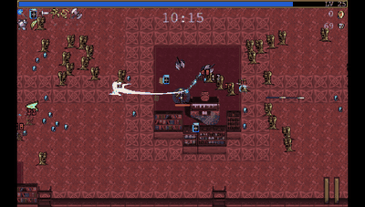
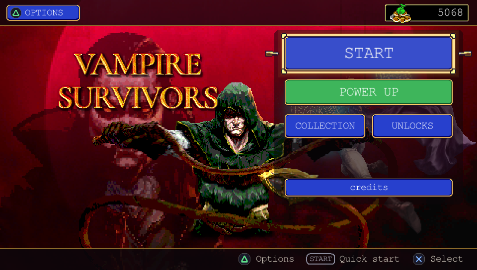
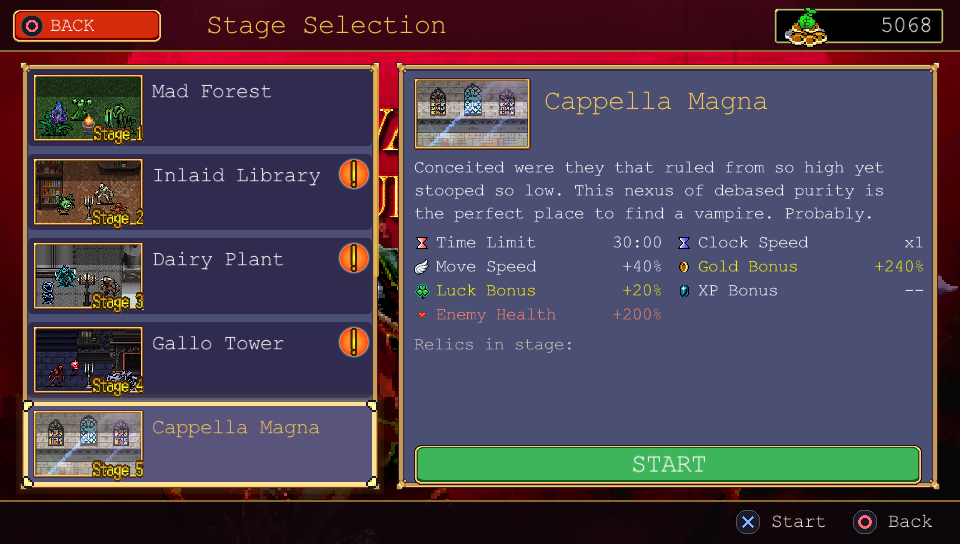
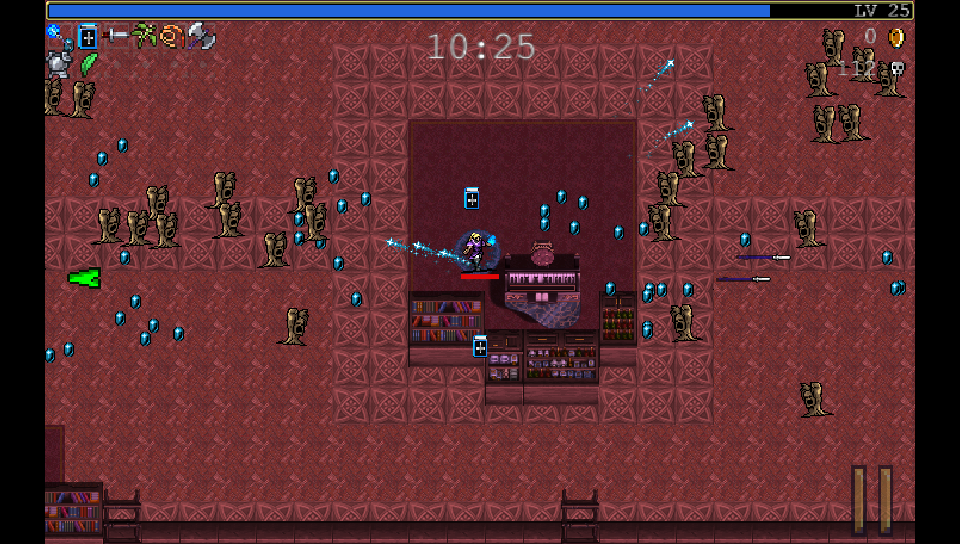
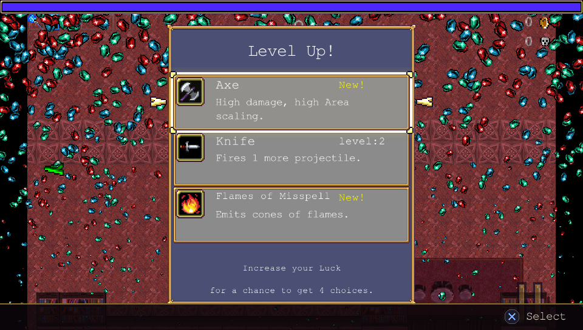

# Vampire Survivors - PS Vita Port

A native PS Vita port of **Vampire Survivors** (poncle, 2022). Not an
emulator and not a wrapper: the Phaser build of the game, the one Steam still
ships as the `old-engine` beta branch, rewritten in C on top of raylib, SDL2
and vitaGL, logic class by class, so it plays like the original.

The whole base game is in: all 15 stages, 41 characters,
the 76 base weapons with evolutions and Limit Break, the 22 Arcanas, relics,
golden eggs, the shop, the collection, the bestiary, achievements, Inverse
and Hyper modes, the endings and credits, and saves in 30 languages.

| | |
|---|---|
|  |  |
|  |  |

*Captured from the desktop preview build, which runs the same game code at the
Vita's 960x544. Frame rate on the real console is covered under Known Issues.*

## Changelog

**v0.9 beta** - first public release: the whole base game, chest videos in
the final stage played by the Vita's hardware decoder, 60 fps in normal play.

## Official Game Download

Vampire Survivors is on Steam. **This port does not include the game**: its
graphics, sounds, music, text and data are not in the VPK. You need your own
copy, and you extract the data from it yourself with the setup tool below. The
only exceptions are the LiveArea images, made from the game's official artwork,
and the screenshots in this README.

## Setup Instructions For End Users

1. **Get the Phaser build.** In Steam, right-click Vampire Survivors,
   Properties, Betas, and pick `old-engine`. Let it download.

2. **Run the setup tool** for your computer (Windows, macOS or Linux / Steam
   Deck; you can find it with each release). It finds your copy of the game on
   its own (Steam, also inside CrossOver/Wine bottles or Flatpak), extracts the
   data and sends it to the Vita:
   - over Wi-Fi: open VitaShell, press SELECT, and type the address it shows;
   - or to a folder / the Vita's memory card in VitaShell's USB mode.

   About 125 MB go to `ux0:data/VampireSurvivors/`. If the connection drops,
   press Prepare again: it only sends what is missing. Nothing needs to be
   installed on the computer: the tool runs the game's own data scripts and
   re-encodes the three chest videos for the Vita by itself.

   From a terminal, the same tool also works without a window:

       python3 tools/vs_setup.py extract "<game folder>" gamedata
       python3 tools/vs_setup.py send "<game folder>" <Vita IP>

   (running it from source needs `pip install quickjs imageio-ffmpeg`).

3. **Install `libshacccg.suprx`** if you have not already (extract it with
   ShaRKBR33D). vitaGL compiles its shaders at runtime and nothing will render
   without it; the tool warns you if it is missing.

4. **Install the VPK** with VitaShell.

## Controls

| Vita | Game |
|---|---|
| Left stick / D-pad | Move, menu navigation |
| Cross | Confirm |
| Circle | Back |
| Start | Pause |
| Triangle / Square | The extra buttons shown in menus |

## Known Issues

- Very heavy waves (around 300 enemies on screen at once) drop to roughly
  25-30 fps: the enemy physics and the draw calls are at the limit of the
  Vita's CPU. Normal play runs at or close to 60 fps.

## Not Included

- The DLCs (Legacy of the Moonspell, Tides of the Foscari).
- Online features and anything tied to Steam.

## Building

You need [VitaSDK](https://vitasdk.org) with vitaGL, SDL2 and a patched build
of the raylib 5.5 Vita port: `patches/raylib-5.5-vita.patch` (batching and
blend-state fixes for vitaGL, faster textured quads, no MSAA, audio enabled).
The Vita audio backend of that raylib only survives as a compiled object, so
each release also ships the prebuilt `libraylib.a` (raylib is zlib-licensed):
drop it into `$VITASDK/arm-vita-eabi/lib/`.

    ./build_vita.sh          # VPK in build_vita/
    ./build_desktop.sh       # desktop preview on macOS (raylib from Homebrew)

The desktop build reads its data from `$VS_DATA` (default `gamedata/`).

## Credits

- **poncle** for making Vampire Survivors. Please buy it, you need it anyway
- **Richard Davey / Photon Storm** for [Phaser](https://github.com/phaserjs/phaser):
  `src/phaser.c` is a C translation of the parts of Phaser 3.55.2 the game uses
- **Rex** for [phaser3-rex-plugins](https://github.com/rexrainbow/phaser3-rex-plugins)
  (ShatterImage), and **ironwallaby** for delaunay-fast
- **Rinnegatamante** for [vitaGL](https://github.com/Rinnegatamante/vitaGL), the
  [raylib 5.5 Vita port](https://github.com/Rinnegatamante/raylib-5.5-vita) and
  ShaRKBR33D
- **Ramon Santamaria (raysan5)** for [raylib](https://github.com/raysan5/raylib)
- **Northfear** for the [SDL2 Vita port](https://github.com/Northfear/SDL)
- **Dave Gamble and contributors** for [cJSON](https://github.com/DaveGamble/cJSON)
- **The [VitaSDK](https://vitasdk.org) team** for the toolchain, and **TheFloW**
  for VitaShell and the groundwork the Vita homebrew scene rests on
- **Fabrice Bellard and Charlie Gordon** for QuickJS, **PetterS** for its
  [Python bindings](https://github.com/PetterS/quickjs), and the
  **[FFmpeg](https://ffmpeg.org)**,
  **[imageio-ffmpeg](https://github.com/imageio/imageio-ffmpeg)** and
  **[PyInstaller](https://pyinstaller.org)** projects, all used by the setup tool

Licenses and notices are in `THIRD_PARTY_NOTICES.md`.

## Disclaimer

This is an unofficial, non-commercial fan project, not affiliated with or
endorsed by poncle.

## License

The source code of this port is released under the MIT License (see
`LICENSE`). Vampire Survivors and everything in it belong to poncle; the
game's data is not part of this repository, and the LiveArea images and
screenshots stay theirs too.
